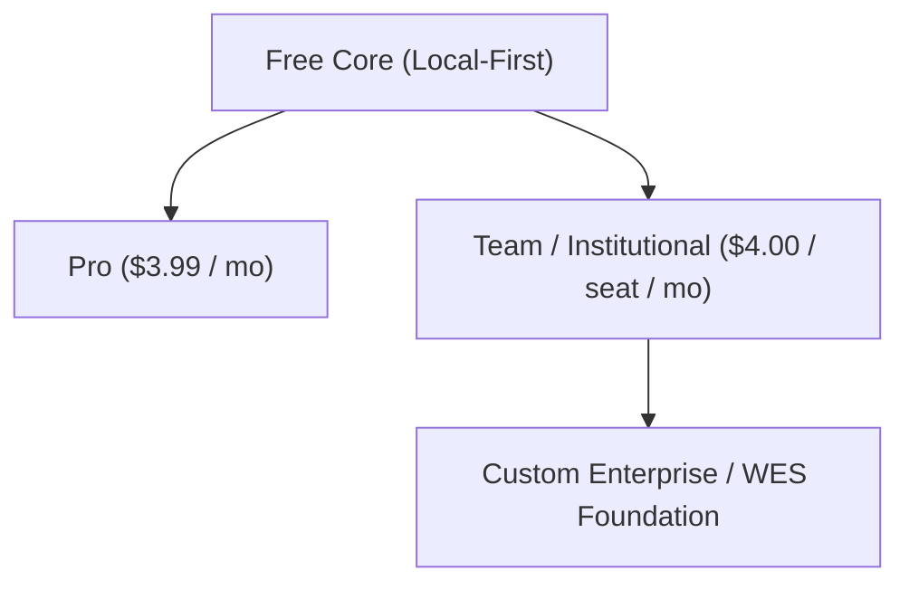
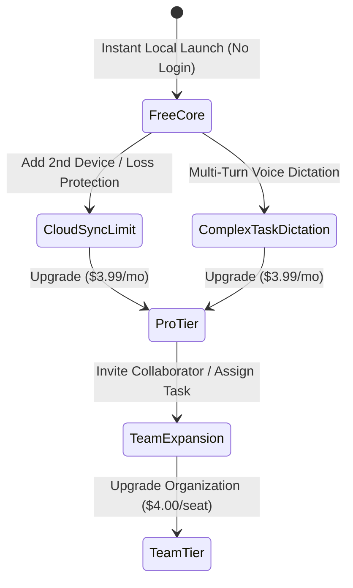

# Waypoint Pricing Strategy & Monetization Architecture

**Document Version:** 1.0.0  
**Target Applications:** WES Foundation Deployment, University Incubators (*Eureka!*, *Imprenditore*, *Pitch-to-Elevate*), Standalone App Distribution  
**System Architecture:** Hybrid Local-First (Flutter + Hive + Supabase + Gemini 3.5 Flash-Lite)

---

## 1. Executive Summary & Value Proposition

Waypoint is a local-first, AI-augmented task execution and workspace system. Unlike cloud-tethered task managers (Motion, Todoist, Asana) that route every transaction through expensive cloud APIs, Waypoint pairs on-device persistence (Hive) and local speech/heuristic engines with targeted Supabase and Gemini Edge functions.

### Core Value Drivers
- **Zero-Latency Offline Execution:** Operates seamlessly without internet connectivity.
- **Ultra-Low Operating COGS:** Local client execution minimizes cloud API burn.
- **Enterprise-Grade Governance:** Weighted Role-Based Access Control (RBAC) and quota enforcement for institutional teams.

---

## 2. Competitive Landscape & Price Benchmarking

| Platform | Pricing Model | Entry Price | Team Tier | AI Capabilities | Offline Support |
| :--- | :--- | :--- | :--- | :--- | :--- |
| **Todoist** | Subscription | Free | \$4.00 / user / mo | Minimal (basic filter AI) | Partial cache |
| **Notion** | Subscription + Add-on | Free | \$10.00 / user / mo + \$8 AI | Generative writing | Minimal |
| **Motion** | Premium Subscription | \$19.00 / mo | \$12.00 / user / mo | Full automated scheduling | No |
| **Linear** | Freemium | Free | \$8.00 / user / mo | Issue triage | Basic cache |
| **Waypoint** | **Open-Core Hybrid** | **Free** | **\$4.00 / seat / mo** | **Local + Flash-Lite Voice** | **Full Local-First (Hive)** |

### Competitive Differentiation
1. **Cost Advantage:** Waypoint's compute cost is orders of magnitude lower than Motion or Notion AI.
2. **Data Sovereignty:** Tasks and transcripts reside locally; institutional data syncs only via dedicated Supabase tenants.
3. **Institutional Synergy:** Native support for WES Foundation initiatives, event ledgers, and student cells.

---

## 3. Tier Design & Feature Matrix

### Tier Comparison Table

| Feature / Capability | Free Core | Pro Tier | Team / Institutional | Enterprise / WES |
| :--- | :---: | :---: | :---: | :---: |
| **Target User** | Students, Individuals | Power Users | Student Orgs, Labs, WES | Universities, Non-Profits |
| **Pricing (Monthly)** | \$0.00 | \$3.99 | \$4.99 / seat | Custom Contract |
| **Pricing (Annual)** | \$0.00 | \$2.99 / mo (\$35.88/yr) | \$3.99 / seat / mo | Custom Contract |
| **Task Persistence** | Local Hive DB | Local Hive + Supabase Cloud | Multi-device Cloud Sync | Dedicated Database Instance |
| **Recurrence Engine** | Daily & Weekly | Custom Intervals & Weekday Grids | Custom + Auto-assignment | Organization-wide Templates |
| **Voice Processing** | Heuristic Parser | Multi-Task Needle AI (Cloud) | Multi-Task Needle AI + TTS | Priority Edge Concurrency |
| **Collaboration** | Local-Only | 2 Workspaces (Self + Guest) | Unlimited Workspaces | Multi-Tenant Hierarchy |
| **RBAC Governance** | Single User | Single User | 3-Tier Weighted RBAC | Custom Role Hierarchies |
| **Audit Logs & Ledger** | None | 30-day History | Full Audit Trail | WES Event/Coupon Ledger |
| **Support SLA** | Community | Standard Email | Priority Support | Dedicated Account Manager |

---

## 4. Unit Economics & Cost Structure Analysis

Waypoint’s hybrid architecture yields industry-leading gross margins because computationally intensive tasks run on client devices.

### Cost of Goods Sold (COGS) Breakdown per User / Month

| Service / Resource | Provider | Consumption Pattern | Cost / Free User | Cost / Pro User | Cost / Team Seat |
| :--- | :--- | :--- | :--- | :--- | :--- |
| **AI Extraction (Tokens)** | Gemini 3.5 Flash-Lite | ~100 calls/mo (Pro), ~200 calls/mo (Team) | \$0.00 (Local) | \$0.015 | \$0.030 |
| **Edge Function Executions** | Supabase Functions | Compute seconds per invocation | \$0.00 | \$0.010 | \$0.020 |
| **Database & Realtime Sync** | Supabase PostgreSQL | Write/read mutations & realtime channels | \$0.00 | \$0.040 | \$0.080 |
| **File Storage** | Supabase Storage | Voice snippets & profile attachments | \$0.00 | \$0.020 | \$0.050 |
| **Notification Services** | Local OS + FCM | Local system delivery | \$0.00 | \$0.005 | \$0.010 |
| **Total Monthly COGS** | | | **\$0.00** | **\$0.090** | **\$0.190** |

### Gross Margin Calculations
- **Pro Tier (\$3.99 / month):**
  - Gross Revenue: \$3.99
  - Est. Payment Gateway Fee (Stripe/Razorpay ~3%): \$0.12
  - COGS: \$0.09
  - **Net Gross Margin:** **\$3.78 (94.7%)**
- **Team Seat (\$4.99 / seat / month):**
  - Gross Revenue: \$4.99
  - Est. Payment Gateway Fee (~3%): \$0.15
  - COGS: \$0.19
  - **Net Gross Margin:** **\$4.65 (93.2%)**

---

## 5. Pricing Psychology & Conversion Triggers

### Strategic Conversion Triggers
1. **Frictionless Zero-Commitment Start:** Free users need no account. Local Hive stores all tasks immediately.
2. **Device Continuity Gate:** Syncing tasks between phone and laptop triggers cloud backup value proposition.
3. **Advanced AI Workflow Gate:** Basic single-task commands are free; multi-task decomposition and interactive voice clarification require Pro.
4. **Weighted RBAC Barrier:** Assigning tasks to external team members triggers organizational onboarding.

---

## 6. Showcase & Investor Pitch Integration (*Eureka!* / *Imprenditore*)

### Pitch Narrative Framework

#### Slide 1: The Problem
- Task tools are fragmented: either bloated project trackers (Jira/Asana) or simplistic lists (Apple Notes).
- AI productivity tools (Motion) charge \$19-\$34/month due to inefficient cloud-first LLM architectures.
- Teams face vendor lock-in and high subscription fatigue.

#### Slide 2: The Waypoint Solution
- **Hybrid Local-First:** High-performance Flutter frontend with on-device Hive storage.
- **Deterministic Needle AI:** Ultra-compact Gemini 3.5 Flash-lite edge verification eliminates parsing hallucinations.
- **Enterprise-Ready Governance:** Built-in weighted RBAC and comment limits.

#### Slide 3: Unit Economics Advantage
- 94%+ gross margins enabled by client-side execution.
- Breakeven achieved at fewer than 50 active Pro subscribers per server cluster.
- Low compute footprint allows sustainable institutional discounts for universities and non-profits.

#### Slide 4: Target Addressable Market (TAM / SAM / SOM)
- **TAM:** Global Task Management & Collaborative Software (\$5.8B by 2027).
- **SAM:** Higher Education, Student Startups, and Independent Developers (\$420M).
- **SOM:** Initial deployment across WES Foundation partners and university innovation cells (15,000 target seats in Year 1).

#### Slide 5: Revenue Forecast (3-Year Projection)

| Milestone | Active Users | Pro Subscribers | Institutional Seats | Annual Run Rate (ARR) |
| :--- | :--- | :--- | :--- | :--- |
| **Year 1 (Q4 2026)** | 10,000 | 400 | 1,200 | \$72,000 |
| **Year 2 (2027)** | 60,000 | 3,200 | 8,000 | \$520,000 |
| **Year 3 (2028)** | 250,000 | 16,000 | 35,000 | \$2,440,000 |

---

## 7. Implementation Roadmap & Milestones

1. **Phase 1: Feature Entitlement Boundaries (Current)**
   - Clean domain separation between local tasks and sync-eligible tasks.
   - Quota tracking for cloud Edge function invocations.
2. **Phase 2: Billing & License Key Management**
   - Supabase customer table integration with Stripe / Razorpay Webhooks.
   - Offline license token validation via cryptographic signatures.
3. **Phase 3: Institutional Portal**
   - Multi-seat management console for WES Foundation campus chapters.
   - Bulk seat provisioning and centralized team analytics.
